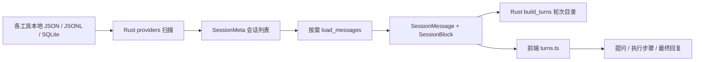
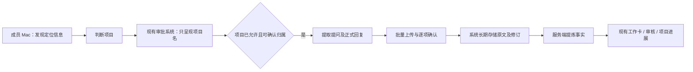

# 项目会话采集器：CC Switch 源码分析与重构边界

调研日期：2026-10-28。状态：五项源码分析已汇总，尚未实现采集器或修改业务代码。

本次分析固定于 CC Switch `4.0.21`，提交 `6d6b7162f122ac0ce1356a14688c8c4f712db3c8`，不代表其他版本的行为。本地源码位于相邻的 `../ccswitch-upstream/cc-switch`。Partner Report 基线为 `51be8ac`。

## 1. 结论

可以从 CC Switch 提取本机会话读取能力，做成独立采集器。成员不必安装 CC Switch，服务器也不需要远程访问成员电脑。成员电脑主动向局域网系统上传。

需要提取的是“存储定位、格式解析、消息身份与分支处理”；需要另做的是“审批前的发现、项目授权、正式回复判定、可靠上传、原文存储”。不能把 `session_manager::scan_sessions()` 和 `load_messages()` 直接包装成上传服务就认为完成。

主要原因：

- 列表扫描经常读取正文生成标题、摘要；它不是审批前可直接使用的发现接口。
- Rust 返回消息块和轮次目录；界面中“提问／步骤／最终回复”的具体切分还在前端 TypeScript 中。
- 非 Codex 工具通常没有统一的 `final_answer` 字段；“最后一段助手文字”不必然表示这一轮正式完成。
- 缓存解决界面重读，不提供持久游标、投递确认、历史补传或服务端幂等。
- 现有 Partner Report 接收的是结构化贡献摘要，并没有接收、长期保存原文的协议。

## 2. 用户已经确认的需求与尚属建议的内容

后续界面讨论已确定完整桌面窗口的三个主要页面：会话首页、上传记录与频率、配置与设置；登录自启动默认开启。菜单栏作为常驻入口。具体见[采集 App 界面需求](SESSION_COLLECTOR_APP_REQUIREMENTS.md)，以下表格保留源码调研时的讨论状态。

| 事项                                                         | 状态                                              |
| ------------------------------------------------------------ | ------------------------------------------------- |
| 提取用户提问和 AI 最终正式回复，排除执行过程、思考、中间说明 | 已确认                                            |
| 原文上传、系统长期保留；本地不做摘要或业务归类，只在上传前隐藏密钥、口令、邮箱、手机号、IP、网址、本机路径和成员标记的内容（见 [隐私信息隐藏](PRIVACY_REDACTION.md)） | 已确认，2026-11-04 调整 |
| 沿用现有项目审批；批准前不能采集正文，拒绝项目不采集         | 已确认                                            |
| 未完成轮次先传提问并标记未完成，后续可补充回复               | 已确认                                            |
| 批准后补传本机仍存在的项目历史会话                           | 已确认                                            |
| 临时会话忽略；审批展示项目名，不展示会话内容                 | 已确认                                            |
| 一个人负责多个项目，沿用成员范围的项目审批                   | 已确认                                            |
| 全员 macOS、公司局域网部署，不要求在家连接                   | 已确认                                            |
| Tauri 菜单栏应用、绑定码、钥匙串、自启动、自动更新           | 方案建议，尚未最终确认                            |
| 非 Git 项目通过选择文件夹登记；普通未登记文件夹忽略          | 方案建议；已确认必须考虑非 Git 项目，具体交互未定 |
| 每 10–15 分钟、唤醒或网络恢复时增量上传                      | 方案建议；用户提出过每天一次，最终采集频率未定    |
| 图片、附件、纯斜杠命令、放弃的分支是否入库                   | 未定；不能声称已完整保留这些内容                  |

格式识别、去除工具注入消息、轮次关联属于采集必需的结构提取，不等于本地摘要。选中的原文应保留原有文本、顺序和换行，不做润色或翻译。

## 3. CC Switch 这条链路实际如何工作



关键源码均在上述固定提交中：

| 源码                                                                                                                                                                  | 作用与可复用范围                                                       |
| --------------------------------------------------------------------------------------------------------------------------------------------------------------------- | ---------------------------------------------------------------------- |
| [`session_manager/mod.rs`](https://github.com/farion1231/cc-switch/blob/6d6b7162f122ac0ce1356a14688c8c4f712db3c8/src-tauri/src/session_manager/mod.rs#L61)            | 分发 13 个 provider 的扫描和读取；不是团队上传接口                     |
| [`model.rs`](https://github.com/farion1231/cc-switch/blob/6d6b7162f122ac0ce1356a14688c8c4f712db3c8/src-tauri/src/session_manager/model.rs)                            | `SessionMessage`、`SessionBlock`、`ContentRef`、`TurnIndex`            |
| [`providers/blocks.rs`](https://github.com/farion1231/cc-switch/blob/6d6b7162f122ac0ce1356a14688c8c4f712db3c8/src-tauri/src/session_manager/providers/blocks.rs#L719) | 非注入的真实 user 消息开启轮次；工具结果不应误算成用户提问             |
| [`cache.rs`](https://github.com/farion1231/cc-switch/blob/6d6b7162f122ac0ce1356a14688c8c4f712db3c8/src-tauri/src/session_manager/cache.rs#L316)                       | 轮次目录与是否存在回复的提示；只在内存缓存 8 个会话、约 96 MiB         |
| [`reader/turns.ts`](https://github.com/farion1231/cc-switch/blob/6d6b7162f122ac0ce1356a14688c8c4f712db3c8/src/components/sessions/reader/turns.ts#L275)               | `locateFinal`、`buildTurn`；实际的提问／步骤／最终回复切分             |
| [`content.rs`](https://github.com/farion1231/cc-switch/blob/6d6b7162f122ac0ce1356a14688c8c4f712db3c8/src-tauri/src/session_manager/content.rs)                        | 源路径校验、延迟读取正文和图片；需要保留边界校验思想，界面分页不必搬走 |

`SessionMeta.project_dir` 是工具记录的工作目录，不是已经判定好的 Git 根目录，也不是系统批准的项目。

`SessionMessage` 包括 `role`、源消息 `id`、`turn_id`、`injected`、时间戳、`blocks` 和元信息。块类型包括 Text、Thinking、ToolCall、ToolResult、Image、Event、Step。普通 `content` 是这些块的展示投影，仍可能包含工具标题、结果、事件，不能直接作为正式回复上传。

前端 `locateFinal` 的规则是：找本轮最后一个 tool_call，再取其后最后一条包含非空 Text 的 assistant 消息中的 Text。它不检查所有工具的完成原因，也不依据 Codex phase 排除 commentary。这是阅读界面的启发式，不能直接升级为“只采正式输出”的保证。

## 4. 六种工具逐项结论

五项详细阅读笔记已随本文件归档：

- [核心模型、缓存、依赖与测试](research/cc-switch/core.md)
- [Codex](research/cc-switch/codex.md)
- [Claude Code](research/cc-switch/claude.md)
- [OpenCode 与 Hermes](research/cc-switch/opencode-hermes.md)
- [Pi 与 Oh My Pi](research/cc-switch/pi-omp.md)

这些笔记是源码阅读结果，包含明确标注的推测，不是运行验证报告。本文件中的交叉核对和修正优先于笔记中的设计建议。

| 工具        | 上游默认存储及定位                                                                                | 项目来源                             | 必须改造的点                                                                        |
| ----------- | ------------------------------------------------------------------------------------------------- | ------------------------------------ | ----------------------------------------------------------------------------------- |
| Codex       | `~/.codex/{sessions,archived_sessions}/**/*.jsonl[.zst]`；CC Switch 设置可覆盖根目录              | `session_meta.payload.cwd`           | 去标题／摘要读取；保留 phase 和轮次生命周期；合并同会话多文件、识别分叉来源         |
| Claude Code | `~/.claude/projects/**/*.jsonl`；CC Switch 设置可覆盖根目录                                       | 首部 cwd，末尾 `relocatedCwd` 可覆盖 | 仅发现定位字段；过滤 sidechain、tool_result、meta、压缩摘要；合并助手消息分片       |
| OpenCode    | `$XDG_DATA_HOME/opencode` 或 `~/.local/share/opencode`；旧 JSON 与 `opencode.db` 并存             | session 的 `directory`               | 去 JSON 标题回退读取；兼容 SQLite 两代 schema；补子会话识别和完成判断               |
| Hermes      | `$HERMES_HOME` 或 `~/.hermes`，也可由 CC Switch 设置覆盖；`state.db` 与 `sessions/*.{jsonl,json}` | `cwd`，回退 `directory`              | 移除 500 条发现上限和首末正文查询；保留压缩去重、活动记录过滤；完成信号较弱         |
| Pi          | `~/.pi/agent/sessions`；有环境变量和 settings 覆盖                                                | session 头的 cwd                     | 发现阶段只读头部定位信息；解析活动分支，不能只按追加顺序切轮次                      |
| Oh My Pi    | `~/.omp/agent/sessions`，受 profile、agent dir、XDG 配置影响                                      | session 头的 cwd                     | 复用 Pi 方言解析；处理头部前的 title 槽、profile 与分支；避免漏采或混采不同 profile |

### 4.1 Codex

依据：`providers/codex.rs:57,248,615,902,1323,1760,1937`；`codex_rollout_file.rs`；`codex_state_db.rs:19`；`codex_config.rs:270`。

- CC Switch 的会话目录解析只使用应用自己的 `codex_config_dir` 设置或 `~/.codex`，不因 `CODEX_HOME` 自动切换。独立采集器需要自己的目录配置，不能继承这项遗漏。
- 原始正文来自 rollout，而不是 state DB。`session_index.jsonl`、`state_5.sqlite` 在该链路仅用于补充标题；采集必需字段不依赖它们。不要把版本号为 5 的数据库文件名当成长期协议。
- 普通文件扫描取头 10 行、尾窗口中的最后 30 行，小于 16 KiB 时会读全文件；压缩文件只解压头 10 行，末次活跃时间回退为文件 mtime。读取正文时支持透明 zstd 解压。
- `response_item/message` 提供提问和助手文本；`event_msg/item_completed` 中的 AgentMessage 可补 phase。重复的事件回显不能再当一份用户／助手消息。
- `phase=final_answer` 是强判据；`phase=commentary` 必须排除。旧格式缺 phase 时不能无条件取最后一条文字，应保留完成事件、工具边界及判定依据；没有足够证据就先上传未完成提问。
- `task_started`、`turn_context` 提供轮次关联，`task_complete`、`turn_aborted` 应保留为采集状态。上游将 task_complete 主要用于清空工具缓冲，没有把完成状态完整输出给采集端。
- 上游跳过 `source` 对象含 `subagent` 的会话，但没有完整判断自动化、exec、MCP。不能简单把所有对象来源或 exec 会话都排除；这可能误排成员主动发起的工作，应根据真实来源元数据建立规则。
- AGENTS、environment_context、系统／开发者消息与 IDE 上下文包装要和真实提问分开。上游“整段被 XML 标签包裹就视为注入”也是启发式；真实用户输入 XML 不应因此被无条件丢弃。
- active／archived 之间没有全局 session-id 去重；`.jsonl` 与同目录同名 `.zst` 同时存在时优先普通文件。相同 session-id 的文件还可能是分页续接，不能简单“选最新文件”，需要识别续接关系、合并并去重。
- fork 会话可能带复制的父历史。应保留 `forked_from_id`、原始 turn/message id；在展示和下游统计中识别同源历史，不可只用内容哈希去掉所有重复文字。
- 上游 `turn_context` 解析没有保留 cwd。跨项目切换不能仅靠初始 session_meta.cwd 将整份会话归到一个项目。

### 4.2 Claude Code

依据：`providers/claude.rs:89,124,279,332,410,564,651,1317`；`config.rs:91`。

- CC Switch 会话读取不使用 `CLAUDE_CONFIG_DIR` 环境变量，独立采集器应自行处理配置与去重；编码后的 projects 子目录名不能可靠还原工作目录。
- 初始 cwd 来自首部记录；显式 `/cd` 的 `relocated` 记录改变会话目录。普通后续记录的 cwd 可能只是 Bash 进入子目录，不应误判项目切换。
- 元数据、正文经常同处一行，没有一个总是独立存在的纯项目头部；这是审批前发现的关键限制，见第 5 节。
- `isSidechain`、`isMeta` 不采；`isCompactSummary` 是系统压缩摘要，不是新提问。全部由 tool_result 构成的 user 记录属于工具结果。
- 同一 `message.id` 的相邻 assistant 记录按块合并；否则可能把一个流式回复当成多条最终回复。
- text、thinking、tool_use 分开；中断提示是 Aborted 信号，`<task-notification>` 等自动插入消息不是成员提问。`stop_reason` 应保留；正常完成值的具体覆盖需要原始工具或样本进一步验证。
- 列表跳过 `agent-*`、`journal.jsonl`，正文也跳过 sidechain。独立采集器不必进入 `subagents` 和 `tool-results` 来获取成员提问及正式回复。
- `/compact`、`/model`、用户 `!cmd` 不能默认为自然语言提问。哪些用户命令应保留是产品规则，不能以抛弃所有斜杠开头文本的方式实现。
- 只取最后一个 cwd 再采整份会话会误收跨项目历史；应识别目录变化的边界，不能证明已授权的部分先不采。

### 4.3 OpenCode

依据：`providers/opencode.rs:19,48,83,147,197,214,339,370,440,690`；`opencode_blocks.rs:79,338,357`；`opencode_config.rs:73`。

- `OPENCODE_DB` 可覆盖数据库位置；相对路径按上游规则相对于数据目录解析。JSON、SQLite 同 id 时上游优先 SQLite。
- SQLite V1 是 `session/message/part`；V2 是 `session_v2/session_message`。混合库还检查 `kv` 中的迁移标记，不能把两套表无条件相加。
- **修正“所有扫描都会读正文”的泛化说法：OpenCode SQLite 列表查询不读取消息正文**，但会取 title；V2 关联 message 表仅聚合更新时间。可改为仅投影 id、directory、时间和实际存在的关系字段。
- 旧 JSON 的 session 无标题时，上游会读取第一条用户消息的 parts 来生成摘要；采集器必须移除此回退逻辑。
- V1 正文按消息时间、id 排序并关联 part；V2 按 `seq,rowid` 排序，部分数据使用 `data.text`，部分使用 `data.content[]`。
- 文本 part 的 `synthetic`、`ignored` 要排除；reasoning、tool、step、patch 不上传。消息 error、`finish`、`time.completed` 应保留给正式完成判断，不能在裁剪中丢掉。
- 上游没有完整的 parent／child 会话过滤。不能凭猜测写死某个 parent 列名；需先探测 schema，再结合真实元数据验证。
- 数据库普通只读打开，采集连接可加有限 busy timeout 和重试；不使用 `immutable=1`，不向源库执行迁移、checkpoint 或写入。

### 4.4 Hermes

依据：`providers/hermes.rs:30,59,81,105,188,407,440,478,691,802,1048`；`hermes_config.rs:53`。

- SQLite 和 JSONL 同 id 时优先 SQLite。列表有 `ORDER BY rowid DESC LIMIT 500`；这是界面扫描限制，会使历史补传漏掉更早的数据库会话，必须分页遍历。
- 上游读取首条 user 和末条 user/assistant 的正文生成标题、摘要；发现阶段不能执行这些查询，也不能使用 `SELECT *` 后丢字段冒充最小读取。
- 数据库正文按 id 插入顺序读取，不能假定 timestamp 单调递增。
- `active`、`compacted` 决定显示范围；压缩可能重新插入同一消息，上游按内容及关联字段去重，保留较合适的 active/id 版本。`display_metadata.model_only` 不作为用户可见消息。
- `reasoning`、`tool_calls` 和 `content` 分列；assistant 同时有 tool_calls 时，content 可能只是过程说明，不是最终输出。
- Hermes JSONL 兼容实现的源码注释明确说明部分字段未经验证；不能据此宣称所有 Hermes 版本都已支持。
- 缺少可靠完成信号及子会话关系时，应保留“无法确认正式结束”的状态，不用静默一段时间自动证明其为正式输出。
- 上游测试 `readonly_reader_sees_committed_wal_without_immutable` 表明普通 SQLite 只读连接能读到已提交 WAL 数据，而 immutable 会漏掉 WAL 中的数据。**不需要手工复制或拼接 WAL**。

### 4.5 Pi / Oh My Pi

依据：`providers/pi.rs:56,151,249,300,381,423,546,609,799`；`pi_blocks.rs:23,93,423`；`omp.rs:17`；`omp_config.rs:85`。

- 两者共用 Pi 解析器，通过 Dialect 区分目录、OMP title 槽和模型字段；不需要维护两套格式解析代码。
- Pi 会话目录优先 `PI_CODING_AGENT_SESSION_DIR`，再读 agent settings 的 `sessionDir`，最后用 agent 下的 sessions。自定义目录采用 flat 布局；默认目录采用 project 子目录布局。相对自定义目录需要项目上下文，上游不会静默回退。
- OMP 还涉及 `OMP_PROFILE`／`PI_PROFILE`、`PI_CONFIG_DIR`、`PI_CODING_AGENT_DIR` 和 XDG 数据目录。菜单栏应用不能假定继承了成员终端的环境变量；应提供本地目录／profile 配置。用户给出的 resume 命令就是一个显式目录配置实例。
- 头部 `type=session` 提供 id、cwd、version、timestamp；OMP 前面可能有 title 槽。发现阶段不需要读后续消息树或标题。
- v2+ 用 id／parentId 构建树，从文件最后一个有效节点回溯到根形成当前分支；v1 视为顺序链。重复 id 取后写入，遇缺失父节点或循环会停止回溯。
- 正文读取只输出该活动分支。归档“所有曾经发生的会话”与“当前可见分支”不同；旧分支是否另存尚未确认，不能在实现时悄悄舍弃后又声称完整归档。
- assistant 的 stopReason 中 aborted、error、length 应影响状态；toolUse 不是正式结束。上游不独立标记 final answer，需要保留 stopReason、块顺序和工具边界。
- 列表限制布局深度来排除子任务；不要误用用于用量统计、会递归包含子任务的 `session_files()`。
- 上游有 128 MiB／50 万树节点限制。采集器可以保留资源保护，但超限必须可见、可重试，不能把未处理会话记为成功。

### 4.6 其余七个 provider 的盘点

这些是存储路径盘点，尚未进行与上述六种工具同等深度的正式回复、授权和完成判定验证。

| Provider             | 存储入口                                                                                                           |
| -------------------- | ------------------------------------------------------------------------------------------------------------------ |
| Gemini               | `~/.gemini/tmp/<projectHash>/chats/*.json\|*.jsonl`，项目根来自 `.project_root`；JSONL 有 `$set`／`$rewindTo` 重放 |
| Grok Build           | `~/.grok/{sessions,archived_sessions}/.../<id>/summary.json` 和 `chat_history.jsonl`                               |
| OpenClaw             | `~/.openclaw/agents/<agent>/sessions/*.jsonl`、`sessions.json`；消息块复用 Pi 解析                                 |
| Kimi                 | `$KIMI_CODE_HOME` 或 `~/.kimi-code` 下的 sessions；`state.json`、`agents/main/wire.jsonl`                          |
| DSH                  | `$DSH_HOME` 或 `~/.dsh` 下的 sessions；最高代 `session.vN.jsonl[.zstd]`                                            |
| Antigravity / agy    | Gemini antigravity brain 目录及 CC Switch profile 目录；`transcript_full.jsonl` 与 `conversation_summaries.db`     |
| MiniMax Code / mcode | `$MINIMAX_DATA_DIR`、`$MAVIS_DATA_DIR` 或 `~/.minimax`；`v2/sqlite/runtime-state.sqlite`                           |

## 5. 审批边界：必须先解决的实际限制

“不采集正文”不能通过“先 load_messages，再把未批准项目丢弃”实现。上游的 title／summary 也不能作为审批项目名，它们可能就是用户原文。审批名应来自项目目录或用户登记的项目名。

发现阶段只需要 provider、session id、cwd／项目定位、时间、来源关系，以及本地 source locator。source locator 留在本机；服务端仍可使用匿名项目身份与显示名称。

但必须区分两个技术边界：

1. 不提取、不实例化、不缓存、不记录、不上传正文：可使用独立元数据查询、精简反序列化结构和跳过未知字段实现，并需要测试证明。
2. 未批准项目的任何正文相关字节都不允许进入进程：部分 JSONL 把 cwd 和正文放在同一条记录里，Codex session_meta 也可能含指令；SQLite 页和预读缓冲也不是按业务字段隔离。仅仅“跳过字段”不能承诺满足这个字节级边界。

用户已经明确不允许碰未批准项目，本次调研没有擅自将其放宽为第一种解释。后续若要求第二种边界，对没有独立定位来源的工具应停止该发现路径，采用用户登记目录或可靠的独立索引；登记本身不等于审批，也不一定解决“某会话属于哪个项目”的映射。不能偷偷扫描正文来完成映射。

跨项目会话同样需要处理：初始 cwd、最后 cwd 都不是整份历史内容的授权证明。应先做目录变化元数据检查，按可证明的项目边界切分；不确定的会话／区间先不采。目录符号链接、Git worktree 的 `.git` 文件和项目根变化均应进入校验。

## 6. 正式回复、轮次身份与增量方案

建议采集器输出以下概念模型；这是接口设计方向，不是已实现的契约：

```text
Session: provider, sourceSessionId, origin/fork information, project binding
Turn: stableTurnId, sourcePromptId, promptParts, finalAnswerParts|null
      completionStatus, completionEvidence, startedAt, endedAt
Delivery: revision, payloadHash, policyVersion, acknowledgedRevision
```

- 用户维度来自服务端认证，不信任请求体自行指定的成员；provider 是原始工具类型，模型供应商作为可选元数据，两者不要混淆。
- 有原生 turn id 时保留；没有时优先使用真实提问消息 id；仍无 id 时用持久映射。不能仅用“第 N 轮”，因为分支、压缩、重排会使轮次序号变化。
- 文本内容哈希用于版本去重，不是轮次主键。相同提问在不同时间出现，仍可能是两轮真实工作。
- 正式回复必须有相应来源的证据；明确 commentary、aborted、error、仍在工具调用中的文本不能充当 final。缺证据时按已确认需求先传提问、标记未完成，不上传猜测为 final 的过程文本。
- `incomplete → complete` 更新同一轮；重新生成、分支切换或回复修订可能再次改变内容，应保存版本／来源，明确当前可见版本。系统已经收到的原文不因本机删除而自动删除。
- mtime＋长度只作变更提示，不是可靠性证明。相同大小改写、恢复旧文件、压缩切换、数据库 WAL 重用均需考虑；应配合文件身份、源版本检查和周期性复核。
- 初版可在获准会话变更后完整重解析，再按稳定轮次 id 与 hash 上传差异；先保证正确，不要过早假设所有 JSONL 都只能追加。
- 普通追加日志以后可采用字节游标；Pi 树、OpenCode 可变 parts、压缩／截断／替换文件不能只读取新字节。游标只越过完整记录；遇 EOF 半行下次继续，不应当成已成功读取。
- SQLite 用正常只读连接读取一致快照，处理锁冲突并重试；指纹纳入 DB 和 WAL。只读是业务连接不写用户数据，不意味着可以绕开 SQLite 自身的 WAL／锁协调。
- 上传成功必须指服务端已持久提交并返回确认；本地仅在确认后推进已送达状态。旧重试不能覆盖较新版本，批量上传需返回逐项结果。

离线队列有一个必须明确的取舍：只保存定位信息、游标和待传标记，能补传“源文件仍在”的历史；如果原文件在离线期间被工具清理，这种队列不能保证恢复原文。若需要一旦本机读到就不再丢失，则需要持久的待确认正文副本或其他等价持久机制。不能同时承诺“本机绝无原文副本”和“源文件删除后仍绝不丢失”；本地队列策略尚待确定。

离线时建议暂停首次正文读取，只记录定位信息；重连后拉取最新授权再读取／发送，避免沿用已经撤销的允许状态。服务端每批也应重新验证项目审批；撤销后停止新采集，已入库历史仍按长期保留要求处理。

## 7. 与现有 Partner Report 的衔接

| 位置                                          | 已核实的现状                                                   | 新链路的处理                                                                             |
| --------------------------------------------- | -------------------------------------------------------------- | ---------------------------------------------------------------------------------------- |
| `plugins/v2/partner-report/src/app-server.ts` | 通过 Codex app-server 获取线程                                 | 新增独立本地 provider 读取核心，不把新采集器寄存在 Codex 调度里                          |
| `plugins/v2/partner-report/src/scan.ts:100`   | 识别 Codex userMessage／final_answer，构建摘要任务             | 新核心只做结构提取；摘要移到服务端                                                       |
| `scan.ts:361`                                 | 会话 key 包含 pluginInstanceId                                 | 设计迁移映射与来源身份，避免换设备身份或新旧客户端共存造成重复统计                       |
| `project-scope.ts:252`                        | 临时目录 → 最长匹配登记目录 → Git 根 → unknown                 | 可复用规则思想；unknown 不能沿用旧行为自动进入审批；Git worktree 与嵌套根要明确          |
| `project-scope.ts:736`                        | 授权线程默认以 effectiveFrom 作为 collectionStartsAt           | 新需求允许批准后补历史，必须把“允许何时开始读取”和“内容最早时间”分开，不能照抄旧时间下限 |
| `docs/PROJECT_SCOPE_RESOLUTION.md`            | v2 按成员范围的完整项目名匹配，并保留匿名身份别名              | 复用现有审批语义；登记目录不绕过审批，跨成员不合并授权                                   |
| `packages/contracts/src/index.ts:79`          | 严格的贡献 schema，包含 summary、contributions，没有原文 turns | 新增独立 transcript 契约；不能把原文硬塞进现有 summary 字段                              |
| `apps/api/src/routes/facts.ts:122`            | 摘要上传接口、敏感内容拦截、幂等和事实写入                     | 原文需新的接收／鉴权／幂等路径，不直接把旧拦截当成新契约                                 |
| `packages/db/src/schema.ts:959`               | session_records 管会话来源版本，session_facts 存提炼事实       | 新增独立原文会话／轮次／修订存储；事实表继续作为派生数据                                 |
| `apps/worker/src/weekly.ts`、`generation.ts`  | 聚合已有事实形成工作卡和报告                                   | 增加“原文轮次 → 结构化事实”任务后衔接现有流程；未完成轮次后续更新要触发失效／重算        |

沿用绑定码、刷新令牌、设备心跳和日志协议是可行方向，但设备与审批记录当前仍关联 plugin instance；是否保留旧实例、如何迁移，必须显式设计。不能只把变量改名为 device 就认为旧权限和去重自然继承。

推荐数据流：



每天生成进展可以独立于采集频率。每天一次也能实现，只要采用持久待办、启动／重连补跑和确认后推进游标；仅在固定时刻运行、失败就等第二天会增加延迟和丢失源历史的机会。持续增量是建议，不是已获确认的需求。

## 8. 如何抽取代码及在设备上存在

建议把读取核心做成不依赖 Tauri 的 Rust 库；先用内部 CLI 校验格式，再接 macOS 菜单栏外壳。CLI 是研发验证入口，不意味着最终让成员靠命令行操作。

| 层                 | 职责                                                           |
| ------------------ | -------------------------------------------------------------- |
| Rust provider 核心 | 可配置根目录、定位信息读取、批准后的格式解析、源消息／分支关联 |
| 采集服务           | 项目映射、审批版本、轮次状态、持久队列、重试、上传确认         |
| macOS 外壳         | 绑定、项目文件夹选择、状态展示、暂停／恢复、启动与更新         |
| 服务端             | 设备认证、审批复核、原文修订存储、中央模型提炼、既有业务流程   |

`session_manager` 的主要解析模块不直接依赖 Tauri；Tauri 通道、命令、终端恢复等主要在外围。可替换各工具的目录 getter，把读取核心和 UI 分开。保留只读部分，不搬删除、改写会话、供应商历史迁移、终端 resume、配置密钥读取等无关能力。

核心外部依赖包括 serde／serde_json、rusqlite、chrono、regex、zstd；图片／展示所用的 base64、url、工具标题／diff 等是否保留取决于附件范围。现有目录遍历主要用 std::fs，不是 walkdir。Pi、OMP 的配置读取还需要显式处理其设置格式与 profile；配置解析不应连带读取认证密钥。

主要 `crate::` 耦合是各工具配置目录模块、Codex rollout 读文件助手、Codex 标题 state DB 助手，以及少数其他 provider 专用索引。Codex state DB 标题部分可去掉；`codex_rollout_file.rs` 中只取读取／压缩识别／去重部分，不带入写回函数。Windows 的 Hermes WSL Python 桥接不属于全员 macOS 的范围。

上游 [`LICENSE`](https://github.com/farion1231/cc-switch/blob/6d6b7162f122ac0ce1356a14688c8c4f712db3c8/LICENSE) 标注 MIT，含 Copyright (c) 2025 Jason Young。复制／修改相关代码时应保留其版权和许可文本，并记录来源提交与本地改造清单；不要将上游同步做成自动覆盖授权与上传逻辑。

菜单栏应用的 Developer ID 签名、公证、目录选择授权、登录启动、升级后权限表现都尚未实测。不能承诺无签名升级一定丢权限，也不能承诺正式应用必然拿到所有目录权限。首次绑定方式和开发者账号情况仍未最终确定。

## 9. 验证范围、修正与后续顺序

本次已完成：读取五项分析报告，交叉核对主要入口、目录 getter、前端 final 切分、SQLite 查询与只读模式、Pi 分支、正文限制，以及本项目契约和权限时间下限。没有运行上游项目、安装依赖、读取其他项目的真实会话正文或向服务器上传数据。

上游已有内联 provider 测试及 `tests/fixtures/sessions` 合同样例，可作为提取后的回归来源，但本次没有运行，样例消息合同也不能代替原始存储格式测试。

需要修正先前讨论和原始分析笔记的说法：

- “CC Switch 已经完全解决正式输出提取”：不成立，界面使用启发式。
- “只搬 Rust session_manager 就行”：不完整，还需重做／移植前端切分并增强完成状态。
- “所有扫描必然读消息正文”：不精确，OpenCode SQLite 元数据查询是例外；即便如此，title 也不适合作为项目审批名。
- “正文统一是 2 MB 上限”：不成立。块内容分页上限是 512 Ki 字符（最多约 2 MiB UTF-8），单次全文读取限制为 32 MiB，图片为 20 MiB；Pi 还有自己的 128 MiB 会话限制。
- “所有长提问／回复都会截断”：不成立。`large_text_block` 主要用于折叠注入等内容，真人提问和最终回复通常保留完整；采集端仍不能把任何 preview 当成已拿到全文。
- “带上 WAL 就是复制 WAL”：不成立；用正常 SQLite 只读连接及其一致性机制，不用 immutable 读活库。
- “第几轮即可稳定去重”：不成立，分支和重放会改变编号。
- “原文上传后下游完全不用动”：不成立，需原文契约、存储、提炼任务和修订失效处理；工作卡以后的业务可争取复用。

后续研发建议按以下验收顺序推进，当前尚未执行：

1. 固化授权发现的技术边界、非 Git 项目登记、跨项目会话处理、附件和分支范围。它们决定能否承诺“不碰未批准正文”和“完整归档”。
2. 在单独 Rust 核心中做六种来源的最小读取验证。使用合成／经过授权的固定样例，输出稳定轮次和完成证据；不连接线上系统。
3. 验证未批准正文不会被提取或落日志、commentary 不会成为 final、未完成后补完成、重复提问不误去重、fork／分支不重复计功、长文不截断、WAL 活库、半行／改写／超限都有可见结果。
4. 设计并实现原文 API、服务端持久确认与修订、审批复核、历史补传时间规则和原文到事实的任务；先在隔离环境接通。
5. 接入 macOS 外壳，实测目录授权、唤醒／断网重连、队列恢复、签名／更新。用测试成员对账，再决定旧插件迁移与停用方式。

完成源码调研只说明抽取路线与主要缺口已明确，不等于已验证所有工具的正式输出可无损、无歧义地采集。
